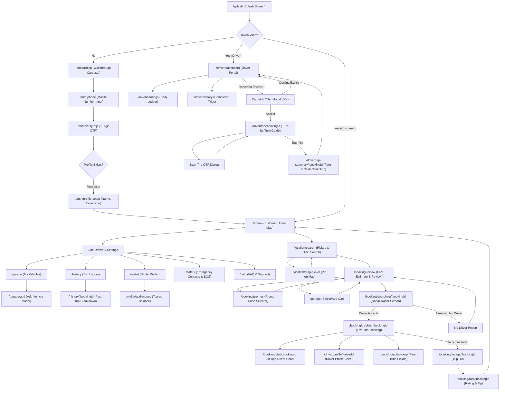
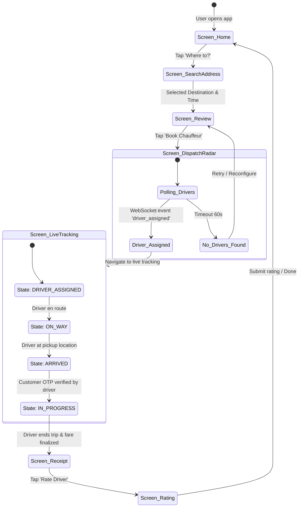

# Application Navigation Map (04_NAVIGATION.md)

This document maps out the entire screen navigation hierarchy, route paths, transitions, and state triggers for both Customer and Driver applications using Mermaid diagrams.

---

## 1. Complete Application Navigation Hierarchy

---

## 2. Booking State & Screen Synchronization Map

---

## 3. Route Configuration Table (`go_router`)

| Route Path | Screen Widget | Guard / Requirement | Transitions |
| :--- | :--- | :--- | :--- |
| `/splash` | `SplashScreen` | None | Replace to `/home` or `/onboarding` |
| `/onboarding` | `OnboardingScreen` | Unauthenticated | Slide to `/auth/phone` |
| `/auth/phone` | `PhoneAuthScreen` | Unauthenticated | Push `/auth/verify-otp` |
| `/auth/verify-otp` | `OtpVerificationScreen` | Unauthenticated | Replace to `/home` or `/auth/profile-setup` |
| `/auth/profile-setup` | `ProfileSetupScreen` | Authenticated (New) | Replace to `/home` |
| `/home` | `HomeScreen` | Authenticated (Customer) | Bottom sheet / Push routes |
| `/location/search` | `LocationSearchScreen` | Authenticated | Push `/booking/review` |
| `/location/map-picker`| `MapPinPickerScreen` | Authenticated | Pop with coordinates |
| `/garage` | `GarageScreen` | Authenticated | Push `/garage/add` |
| `/garage/add` | `AddVehicleModal` | Authenticated | Pop on save |
| `/booking/review` | `BookingReviewScreen` | Authenticated | Push `/booking/searching/:id` |
| `/booking/searching/:id` | `DriverSearchScreen` | Authenticated | Replace to `/booking/tracking/:id` |
| `/booking/tracking/:id` | `TripTrackingScreen` | Authenticated | Replace to `/booking/receipt/:id` |
| `/booking/chat/:id` | `ChatScreen` | Authenticated | Push / Pop |
| `/booking/receipt/:id`| `TripReceiptScreen` | Authenticated | Push `/booking/rate/:id` |
| `/booking/rate/:id` | `RatingTipScreen` | Authenticated | Pop to `/home` |
| `/history` | `TripHistoryScreen` | Authenticated | Push `/history/:id` |
| `/wallet` | `WalletScreen` | Authenticated | Push `/wallet/add-money` |
| `/safety` | `SafetySettingsScreen`| Authenticated | Push `/safety/emergency-contacts` |
| `/driver/dashboard` | `DriverHomeScreen` | Authenticated (Driver) | Bottom sheet / Full-screen trip |
| `/driver/trip/:id` | `DriverTripScreen` | Authenticated (Driver) | Replace to `/driver/trip-summary/:id` |
| `/driver/earnings` | `DriverEarningsScreen`| Authenticated (Driver) | Push / Pop |
