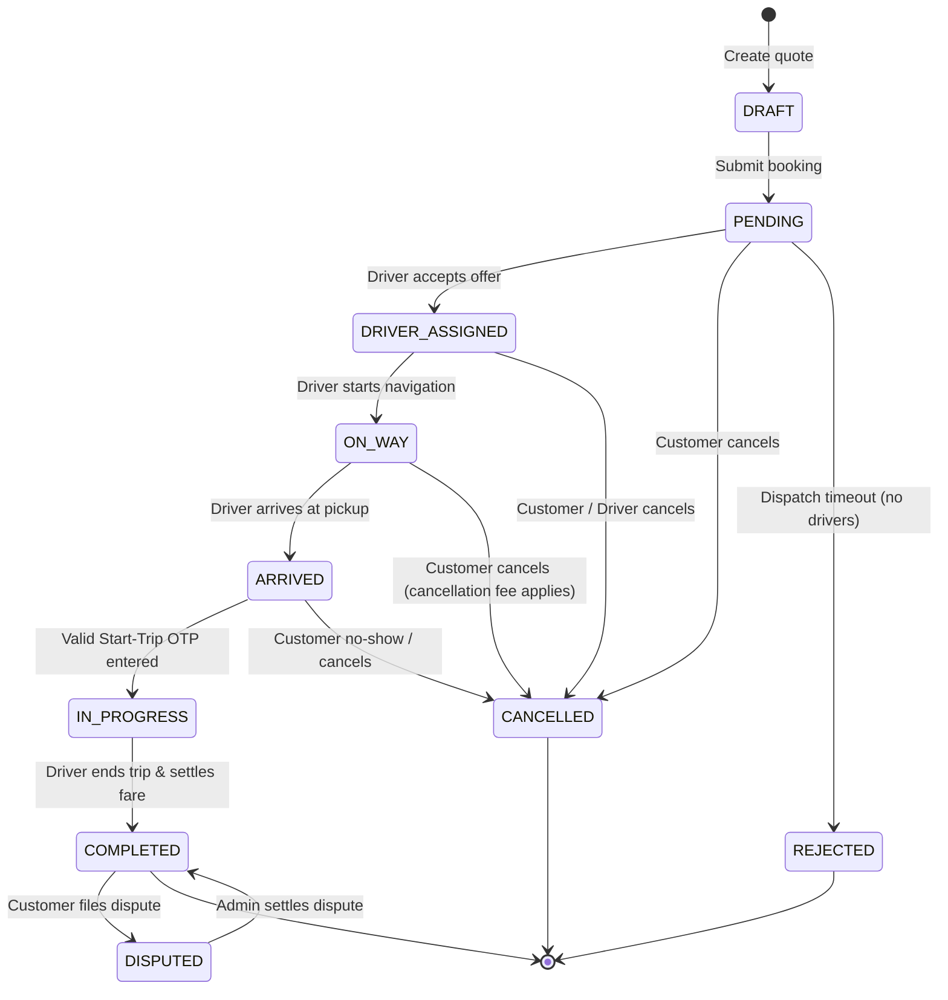

# Booking State Machine Specification (06_STATE_MACHINE.md)

This document formalizes the Booking State Machine, including state definitions, legal transitions, trigger events, actors, database mutations, and external side effects.

---

## 1. Booking State Definitions

| State Name | Identifier | Description |
| :--- | :--- | :--- |
| **Draft** | `DRAFT` | Customer is configuring addresses, car selection, and reviewing fare. Not yet submitted. |
| **Pending** | `PENDING` | Booking confirmed by customer; dispatch engine is actively querying Redis GEO for drivers. |
| **Driver Assigned** | `DRIVER_ASSIGNED` | Chauffeur accepted dispatch offer. 4-digit Start-Trip OTP generated. |
| **On the Way** | `ON_WAY` | Driver has departed their location and is actively driving towards customer pickup address. |
| **Arrived** | `ARRIVED` | Driver reached pickup location, parked, and notified customer. Waiting for customer. |
| **In Progress** | `IN_PROGRESS` | Customer Start-Trip OTP verified. Chauffeur is driving customer vehicle. Metering active. |
| **Completed** | `COMPLETED` | Destination reached. Chauffeur ended trip. Total elapsed time calculated and fare finalized. |
| **Cancelled** | `CANCELLED` | Booking cancelled by customer, driver, or admin prior to trip start. |
| **Rejected** | `REJECTED` | Dispatch engine failed to match a driver within timeout (60s) or all candidates declined. |
| **Disputed** | `DISPUTED` | Post-trip dispute raised (e.g. fare disagreement, vehicle damage report). |

---

## 2. State Transition Diagram

---

## 3. Transition Rules & Side Effects Matrix

| Transition | Allowed Actor | Preconditions | Side Effects & Actions |
| :--- | :--- | :--- | :--- |
| `DRAFT -> PENDING` | Customer | Valid pickup lat/lng, car ID selected, fare quote valid | Triggers Redis dispatch queue; starts 60s timeout task; pushes WebSocket event `BOOKING_CREATED`. |
| `PENDING -> DRIVER_ASSIGNED` | Driver | Candidate driver online & qualified for transmission | Generates 4-digit Start OTP; sets `driver_id`; publishes `DRIVER_ASSIGNED` to trip WebSocket & push notification. |
| `PENDING -> REJECTED` | System | 60s dispatch timeout reached without acceptance | Emits `DISPATCH_EXPIRED` event; releases search lock; prompts customer to retry or schedule. |
| `PENDING -> CANCELLED` | Customer / Admin | Booking still in `PENDING` | Cancels pending dispatch tasks; emits `BOOKING_CANCELLED`; no fee charged. |
| `DRIVER_ASSIGNED -> ON_WAY` | Driver | Driver presses "Start Driving to Pickup" | Emits `DRIVER_EN_ROUTE` event; starts live GPS telemetry stream. |
| `DRIVER_ASSIGNED -> CANCELLED` | Customer / Driver | Within free cancellation window (e.g. 5 min) | If customer cancels > 5 mins, applies cancellation fee ($5.00); releases driver to `ONLINE`. |
| `ON_WAY -> ARRIVED` | Driver | Driver GPS within 100m of pickup address | Emits `DRIVER_ARRIVED` push alert to customer ("Your chauffeur has arrived"). |
| `ARRIVED -> IN_PROGRESS` | Driver | Provided OTP matches stored 4-digit OTP | Sets `trip_start_time = NOW()`; emits `TRIP_STARTED` event; starts meter. |
| `IN_PROGRESS -> COMPLETED` | Driver / Admin | Driver reaches destination, taps "End Trip" | Computes `actual_duration` & `actual_distance`; calculates final bill; processes wallet/card charge; emits `TRIP_COMPLETED`. |
| `COMPLETED -> DISPUTED` | Customer | Within 48 hours of trip completion | Freezes driver payout for trip; creates ticket in Admin Dispute queue. |
| `DISPUTED -> COMPLETED` | Admin | Review completed and adjustment applied | Emits `DISPUTE_RESOLVED`; unfreezes payout; updates finalized fare. |

---

## 4. Illegal Transitions & Defensive Invariants
1. **No Skip Transitions**: `DRIVER_ASSIGNED` cannot transition directly to `IN_PROGRESS` without passing through `ARRIVED` and verifying the Customer OTP.
2. **Terminal Invariance**: `COMPLETED`, `CANCELLED`, and `REJECTED` are terminal states (except `COMPLETED <-> DISPUTED`). A cancelled booking cannot be revived.
3. **Double Assignment Guard**: When a driver accepts an offer, Redis distributed lock (`SETNX`) guarantees that two drivers cannot simultaneously claim the same booking.
4. **OTP Invalidation**: The OTP is invalidated and purged from memory immediately after transition to `IN_PROGRESS`.
