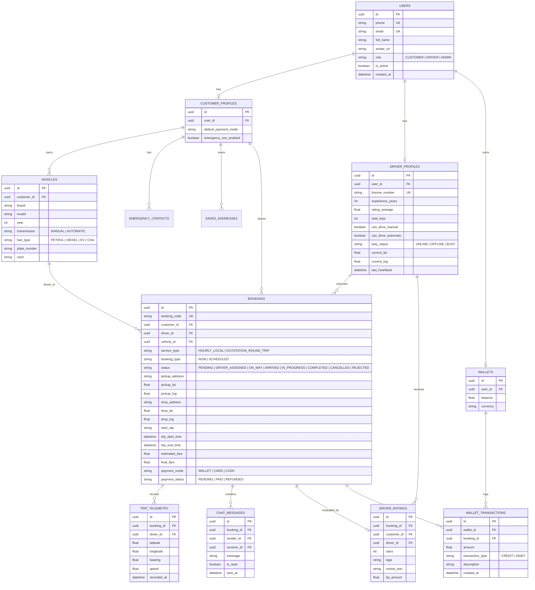

# Data Models & Entity Relationship Diagram (07_DATA_MODELS.md)

This document specifies the PostgreSQL relational database schema and SQLAlchemy ORM models, including entity definitions, types, constraints, indexes, and an Entity Relationship (ER) diagram.

---

## 1. Entity-Relationship (ER) Diagram

---

## 2. Table Specifications & Database Indexes

### 2.1 Table: `users`
- `id`: `UUID`, Primary Key, default `gen_random_uuid()`.
- `phone`: `VARCHAR(20)`, Unique, Not Null, Indexed.
- `email`: `VARCHAR(255)`, Unique, Nullable.
- `hashed_password`: `VARCHAR(255)`, Nullable (supports passwordless OTP or password).
- `full_name`: `VARCHAR(100)`, Not Null.
- `avatar_url`: `TEXT`, Nullable.
- `role`: `VARCHAR(20)`, Not Null, default `'CUSTOMER'` (Enum: `CUSTOMER`, `DRIVER`, `ADMIN`).
- `is_active`: `BOOLEAN`, default `TRUE`.
- `created_at`: `TIMESTAMPTZ`, default `NOW()`.
- `updated_at`: `TIMESTAMPTZ`, default `NOW()`.

### 2.2 Table: `driver_profiles`
- `id`: `UUID`, Primary Key.
- `user_id`: `UUID`, Foreign Key (`users.id`), On Delete Cascade, Unique.
- `license_number`: `VARCHAR(50)`, Not Null, Unique.
- `experience_years`: `INTEGER`, default `0`.
- `rating_average`: `NUMERIC(3, 2)`, default `5.00`.
- `total_trips`: `INTEGER`, default `0`.
- `can_drive_manual`: `BOOLEAN`, default `TRUE`.
- `can_drive_automatic`: `BOOLEAN`, default `TRUE`.
- `duty_status`: `VARCHAR(20)`, default `'OFFLINE'` (`ONLINE`, `OFFLINE`, `BUSY`), Indexed.
- `current_lat`: `NUMERIC(10, 7)`, Nullable.
- `current_lng`: `NUMERIC(10, 7)`, Nullable.
- `last_heartbeat`: `TIMESTAMPTZ`, Nullable.

### 2.3 Table: `vehicles`
- `id`: `UUID`, Primary Key.
- `customer_id`: `UUID`, Foreign Key (`users.id`), On Delete Cascade, Indexed.
- `brand`: `VARCHAR(50)`, Not Null.
- `model`: `VARCHAR(50)`, Not Null.
- `year`: `INTEGER`, Nullable.
- `transmission`: `VARCHAR(20)`, Not Null (`MANUAL`, `AUTOMATIC`), Indexed.
- `fuel_type`: `VARCHAR(20)`, default `'PETROL'`.
- `plate_number`: `VARCHAR(20)`, Not Null.
- `color`: `VARCHAR(30)`, Nullable.
- `is_default`: `BOOLEAN`, default `FALSE`.

### 2.4 Table: `pricing_rules`
- `id`: `UUID`, Primary Key.
- `city`: `VARCHAR(50)`, Not Null, Indexed.
- `service_type`: `VARCHAR(30)`, Not Null (`HOURLY_LOCAL`, `OUTSTATION_ROUND_TRIP`).
- `base_hours`: `NUMERIC(4, 1)`, default `2.0`.
- `base_fare`: `NUMERIC(8, 2)`, default `25.00`.
- `extra_minute_rate`: `NUMERIC(6, 2)`, default `0.20`.
- `night_charge_start_hour`: `INTEGER`, default `22`.
- `night_charge_end_hour`: `INTEGER`, default `6`.
- `night_charge_flat`: `NUMERIC(6, 2)`, default `5.00`.
- `surge_multiplier`: `NUMERIC(3, 2)`, default `1.00`.
- `is_active`: `BOOLEAN`, default `TRUE`.

### 2.5 Table: `bookings`
- `id`: `UUID`, Primary Key.
- `booking_code`: `VARCHAR(20)`, Unique, Not Null, Indexed.
- `customer_id`: `UUID`, Foreign Key (`users.id`), Not Null, Indexed.
- `driver_id`: `UUID`, Foreign Key (`users.id`), Nullable, Indexed.
- `vehicle_id`: `UUID`, Foreign Key (`vehicles.id`), Not Null.
- `service_type`: `VARCHAR(30)`, Not Null.
- `booking_type`: `VARCHAR(20)`, default `'NOW'`.
- `scheduled_pickup_time`: `TIMESTAMPTZ`, Nullable.
- `status`: `VARCHAR(30)`, default `'PENDING'`, Indexed.
- `pickup_address`: `TEXT`, Not Null.
- `pickup_lat`: `NUMERIC(10, 7)`, Not Null.
- `pickup_lng`: `NUMERIC(10, 7)`, Not Null.
- `drop_address`: `TEXT`, Nullable.
- `drop_lat`: `NUMERIC(10, 7)`, Nullable.
- `drop_lng`: `NUMERIC(10, 7)`, Nullable.
- `start_otp`: `VARCHAR(6)`, Nullable.
- `trip_start_time`: `TIMESTAMPTZ`, Nullable.
- `trip_end_time`: `TIMESTAMPTZ`, Nullable.
- `estimated_fare`: `NUMERIC(8, 2)`, Not Null.
- `final_fare`: `NUMERIC(8, 2)`, Nullable.
- `payment_mode`: `VARCHAR(20)`, default `'WALLET'`.
- `payment_status`: `VARCHAR(20)`, default `'PENDING'`.
- `cancellation_reason`: `TEXT`, Nullable.
- `cancellation_fee`: `NUMERIC(6, 2)`, default `0.00`.
- `created_at`: `TIMESTAMPTZ`, default `NOW()`, Indexed.
- `updated_at`: `TIMESTAMPTZ`, default `NOW()`.

### 2.6 Table: `wallets` & `wallet_transactions`
- Wallet balance updated with row-level locking (`SELECT ... FOR UPDATE`) to prevent race conditions.
- Every financial change creates an immutable transaction entry in `wallet_transactions`.
